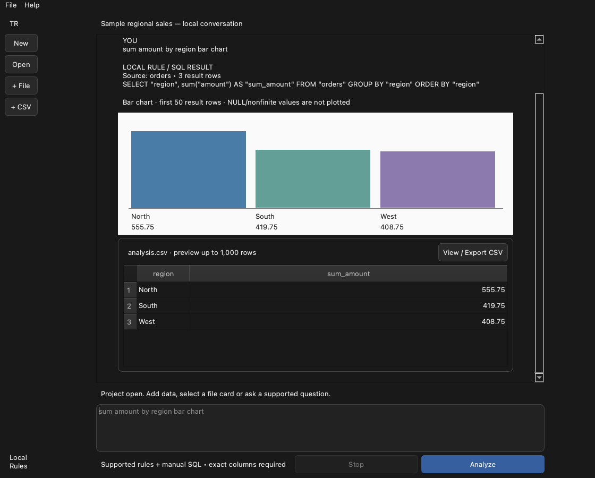

# Tables Replica: a local data conversation prototype

Experimental original recreation of the observed conversation → analysis → chart → CSV artifact workflow, with a narrow rail, centered feed, question composer and export preview. **Partial parity:** supported deterministic questions and manual SQL only. Arbitrary AI analysis, full Julius feature/layout parity, accounts and hosted models are absent. No affiliation, vendor code, logo or reference assets.

This is the separate Neutral Core replica. [Pip Tables](https://github.com/Ghostzy0/pip-tables) retains the custom workbench with neutral/Pip appearances and Plus import inspection/pages. Both pin the same licensed engine; see [provenance](UPSTREAM.md) and SHARED-CORE.json.



## Set up on a Mac

Python 3.13, Apple Silicon macOS 13+. Dependencies download from PyPI during setup; the app has no network/provider/account runtime. Intel/Windows desktop acceptance is unverified.

```sh
python3.13 -m venv .venv
.venv/bin/python -m pip install -r requirements-lock.txt
.venv/bin/python scripts/verify_core.py
QT_QPA_PLATFORM=offscreen .venv/bin/python -m unittest discover -s tests -v
.venv/bin/python launch.py --smoke /tmp/tables-replica-smoke.json
.venv/bin/python launch.py
```

New project → choose an empty folder → Add file or Paste CSV. Supported questions: `count rows`, `preview`, `sum amount`, `count amount`, `nulls amount`, `sum amount by region bar chart`, or `SQL: SELECT …`. Substitute exact imported column names. Unsupported questions preserve prior artifacts. CmdReturn analyzes; CmdN creates, CmdO opens, CmdI imports. Stop requests cooperative interruption; closing during work waits safely. Native minimum 900×720; result tables scroll and use lazy cells.

CSV/XLSX/JSON/NDJSON/Parquet imports use the shared bounded engine. The replica currently exposes single-sheet XLSX; the custom Plus workbench has a sheet picker. File cards select imported data. Manual SQL provenance is explicit. Signed charts use a zero baseline and label missing/nonfinite values; exact values remain in the artifact table. View/Export CSV opens a preview, then a native save panel. Export reruns the displayed SQL and refuses existing destinations; time/random values can change.

Projects retain plaintext data.duckdb, project.json and replica.json on your Mac. The sidecar keeps at most 40 conversation entries and 4 MiB. Back up the entire folder while closed. Failed sidecar writes preserve prior conversation; completed imports are recoverable on reopen. No personal folder scanning or automatic cloud backup. Preserve original selected files. To remove your retained data, quit and remove only the project folder you chose.

## Build and evidence

```sh
.venv/bin/python scripts/build.py
'dist/Tables Replica.app/Contents/MacOS/Tables Replica' --smoke /tmp/replica-package-smoke.json
```

The script bundles notices and declared runtime/native inventory, then ad-hoc signs and verifies the arm64 bundle. It does not notarise or establish publisher identity. Use source setup if macOS blocks a download; do not disable system security globally. [Verification](docs/VERIFICATION.md) states what actually ran. Headless tests are separate from native/package/VoiceOver/second-host acceptance.

## About

Maintained by [Ghostzy0](https://github.com/Ghostzy0), original MIT application with dynamic LGPLv3 Qt/PySide and MIT DuckDB/openpyxl. No private recordings, full theme guide, proprietary motion or model weights. [Julius guide](https://julius.ai/faq/chat-start-guide) is the workflow reference; bounded free synthetic analysis/chart/CSV-preview observed. Actual reference file-upload/download and broader behavior remain unverified. [FAQ and how-to](docs/FAQ.md), [AI setup](docs/AI-SETUP.md), [change notes](CHANGELOG.md), [security](SECURITY.md), [licences](THIRD-PARTY-NOTICES.md).
